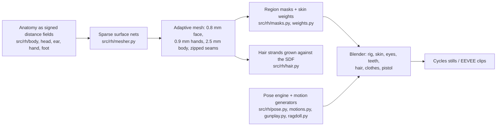

# REAL: a human built from scratch in Blender

A realistic adult man sculpted, shaded, groomed, dressed, rigged and animated entirely by code
(Python + Blender 5.1). Nothing is downloaded: no scans, no MakeHuman/MetaHuman, no textures,
no HDRIs, no motion capture. Every surface and every motion comes from the scripts in this repo.

Progress site with previews: https://subtoferalsloth11.github.io/realistic-human/

## How it is made



- **Sculpting.** The body is a program of signed-distance primitives evaluated with numpy:
  lofted skin envelopes whose superelliptic cross-sections follow adult male anthropometry
  (1.80 m), soft displacement "bumps" for muscles and bony landmarks, and a bicubic heightfield
  through a table of facial soft-tissue depths for the face. Features that overhang (nose
  cartilages, alar rims, eyelids cut by two lid planes through the canthi, ears, nails) are
  smooth CSG on top. The lips are swellings along the dental arch with a vermilion-border ridge.
- **Meshing.** `src/rh/mesher.py` refines a coarse lattice only where the surface can be,
  evaluates the field exactly near it, and runs surface nets in z-slabs. The head, hands and
  feet are meshed finer and zipped onto the body along cut planes (`src/rh/stitch.py`).
- **Look.** Random-walk skin subsurface scattering with procedural pores, micro-furrows,
  mottling and anatomically placed colour zones (lips, cheeks, beard shadow, lids, nails,
  mouth). Eyes have a recessed iris under a refractive cornea (IOR 1.376) and a procedural iris.
  Hair uses the Chiang model in Cycles (Kajiya-Kay in EEVEE previews).
- **Rig.** 66 bones with Unreal-mannequin names, eyelid bones pivoting on the globe centre,
  forearm twist. Weights come from the sculpt itself: each primitive knows its bone, so region
  membership is a soft-min over the primitives' own distance fields.
- **Motion.** A numpy pose engine (FK, analytic two-bone IK with per-bone hinge frames) drives
  procedural, biomechanics-based clips: gait with heel strike / foot roll / toe-off and
  reach-consistent hip height, run, jump and backflip with ballistic flight about the centre of
  mass, crouch, punches, and a full pistol routine. Falls and the hit reaction use a Verlet
  ragdoll with muscle tone.

## Build

```sh
python3 src/build_final.py                 # adaptive mesh + masks + weights  -> build/human.npz, rig.json
python3 src/build_hair.py build/human.npz  # hair strands                     -> build/hair.npz
python3 src/build_teeth.py                 # teeth, gums, tongue              -> build/teeth_*.npz
python3 src/build_clothes.py               # t-shirt, jeans, sneakers         -> build/{shirt,jeans,shoes}.npz
```

Blender scripts (run with `blender -b --factory-startup --python <script> -- <args>`; on this
machine every Blender run goes through `~/.agents/bin/heavy`):

| Script | Output |
|---|---|
| `blender/clay.py` | clay renders of any meshed region |
| `blender/portrait.py` | Cycles head look-dev |
| `blender/proof.py` | EEVEE proof stills of several clips |
| `blender/clip.py` | one animation clip to MP4 |
| `blender/pistol_clip.py` | the pistol routine (full + draw/shoot/reload/holster cuts) |
| `blender/hero.py` | Cycles hero stills and an EEVEE turntable |
| `blender/pistol.py` | the pistol on its own |

## Layout

| Path | What |
|---|---|
| `src/rh/sdf.py` | primitives, lofts, heightfields, bumps, smooth CSG |
| `src/rh/mesher.py`, `stitch.py` | surface nets, adaptive zipping |
| `src/rh/skeleton.py`, `body.py`, `head.py`, `ear.py`, `hand.py`, `foot.py`, `teeth.py` | anatomy |
| `src/rh/masks.py`, `weights.py`, `rig.py` | shading masks, skin weights, bones |
| `src/rh/hair.py` | strand growth |
| `src/rh/pose.py`, `motions.py`, `gunplay.py`, `ragdoll.py` | animation |
| `blender/` | Blender-side assembly, shaders, rendering |
| `docs/` | the progress site (GitHub Pages) |
