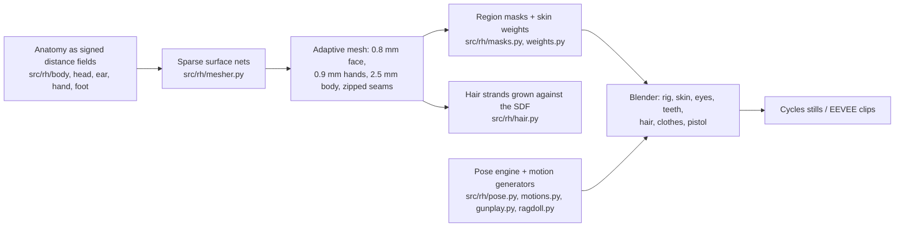

# REAL: a human built from scratch in Blender

A realistic adult man sculpted, shaded, groomed, dressed, rigged and animated entirely by code
(Python + Blender 5.1). Nothing is downloaded: no scans, no MakeHuman/MetaHuman, no textures,
no HDRIs, no motion capture. Every surface and every motion comes from the scripts in this repo.

Progress site with previews and every animation: https://subtoferalsloth11.github.io/realistic-human/

**Download the finished character:** [`realistic_human.blend`](https://github.com/SubToFeralsloth11/realistic-human/releases/tag/v1.0)
(Blender 5.1, 206 MB: body, eyes, teeth, hair, clothes, pistol, rig, and every clip as an action;
select `Rig` and pick an action in the Action editor).

## How it is made



- **Sculpting.** The body is a program of signed-distance primitives evaluated with numpy:
  lofted skin envelopes whose superelliptic cross-sections follow adult male anthropometry
  (1.80 m), soft displacement "bumps" for muscles and bony landmarks, and a bicubic heightfield
  through a table of facial soft-tissue depths for the face. Features that overhang (nose
  cartilages, alar rims, eyelids cut by two lid planes through the canthi, ears, nails) are
  smooth CSG on top. The lips are swellings along the dental arch with a vermilion-border ridge.
- **Meshing.** `src/rh/mesher.py` refines a coarse lattice only where the surface can be,
  evaluates the field exactly near it, and runs surface nets in z-slabs. The head, hands and
  feet are meshed finer and zipped onto the body along cut planes (`src/rh/stitch.py`).
- **Look.** Random-walk skin subsurface scattering with procedural pores, micro-furrows,
  mottling and anatomically placed colour zones (lips, cheeks, beard shadow, lids, nails,
  mouth). Eyes have a recessed iris under a refractive cornea (IOR 1.376) and a procedural iris.
  Hair (110k scalp strands, stubble, brows, lashes on the eyelid bones) uses the Chiang model in
  Cycles; EEVEE gets its own simpler outputs for hair, corneas and denim.
- **Mouth.** 28 teeth sized from adult averages on a parabolic dental arch, gums and tongue
  (`src/rh/teeth.py`), inside an oral cavity carved behind the lips; the lower set rides the jaw.
- **Clothes.** T-shirt, five-pocket jeans and leather sneakers are built from the body's own
  distance field: a convex-hull drape plus ease where cloth hangs free, folds modelled into the
  geometry (waist drape, sleeve bunching, knee and hem stacking), real pocket openings and bags.
  Shaders read per-vertex chart coordinates for knit, twill, topstitching and wear. Garments
  copy the body's skin weights, so they follow the rig (there is no cloth simulation).
- **Pistol.** A compact 9 mm with a moving slide, tilting barrel, trigger, slide stop, magazine
  release, removable magazines, cartridges, ejected casings and a muzzle flash.
- **Rig.** 66 bones with Unreal-mannequin names, eyelid bones pivoting on the globe centre,
  forearm twist, jaw. Weights come from the sculpt itself: each primitive knows its bone, so
  region membership is a soft-min over the primitives' own distance fields.
- **Motion.** A numpy pose engine (FK, analytic two-bone IK with per-bone hinge frames) drives
  procedural, biomechanics-based clips: gait with heel strike / foot roll / toe-off and
  reach-consistent hip height, run, jump and backflip with ballistic flight about the centre of
  mass, crouch, a punch combo, and the pistol routine (draw from the jeans pocket, three shots
  with slide cycling and casings, reload from the other pocket, put it back). Falls and the hit
  reaction hand over to a Verlet ragdoll with muscle tone, then reconstruct the bones from it.

## Limitations

Honest about what "from scratch" reaches:

- It is a convincing CG human, not a scan. Skin detail is procedural (no measured albedo or
  pore maps), so close-ups read as very good CG rather than photographs.
- No cloth simulation: garments are skinned, so they do not swing or slide on the body. A hand
  or the pistol entering the pocket passes through the denim.
- The face has jaw, eyelid and gaze controls but no full expression rig (no FACS shapes).
- Hands have no knuckle creases or skin wrinkles, so they read as smooth in close-up; the support
  hand's thumb rides the slide in the aiming pose.
- A faint line remains down the right side of the neck in raking light, and the sneaker uppers
  have two small openings near the toe box.
- The animation previews use EEVEE for speed (with the stubble carried by the skin shader, since
  EEVEE draws strands too thick); the Cycles stills show the intended shading.

## Build

```sh
python3 src/build_final.py                 # adaptive mesh + masks + weights  -> build/human.npz, rig.json
python3 src/build_hair.py build/human.npz  # hair strands                     -> build/hair.npz
python3 src/build_teeth.py                 # teeth, gums, tongue              -> build/teeth_*.npz
python3 src/build_clothes.py               # t-shirt, jeans, sneakers         -> build/{shirt,jeans,shoes}.npz, pocket.json
tools/render_all.sh                        # every clip to renders/clips + web copies in docs/media/clips
python3 -m unittest discover tests         # IK, ragdoll and anatomy regression tests (~40 s, no Blender)
```

Blender scripts (run with `blender -b --factory-startup --python <script> -- <args>`; on this
machine every Blender run goes through `~/.agents/bin/heavy`):

| Script | Output |
|---|---|
| `blender/clay.py` | clay renders of any meshed region |
| `blender/portrait.py` | Cycles head look-dev |
| `blender/proof.py` | EEVEE proof stills of several clips |
| `blender/clip.py` | one animation clip to MP4 |
| `blender/pistol_clip.py` | the pistol routine (full + draw/shoot/reload/holster cuts) |
| `blender/hero.py` | Cycles hero stills and an EEVEE turntable |
| `blender/pistol.py` | the pistol on its own |
| `blender/clothes.py` | garment loading, shaders, rig binding, dressed preview |
| `blender/export_blend.py` | the whole character with every clip as an action, saved as one `.blend` |

## Layout

| Path | What |
|---|---|
| `src/rh/sdf.py` | primitives, lofts, heightfields, bumps, smooth CSG |
| `src/rh/mesher.py`, `stitch.py` | surface nets, adaptive zipping |
| `src/rh/skeleton.py`, `body.py`, `head.py`, `ear.py`, `hand.py`, `foot.py`, `teeth.py` | anatomy |
| `src/rh/masks.py`, `weights.py`, `rig.py` | shading masks, skin weights, bones |
| `src/rh/hair.py`, `clothes.py` | strand growth, garments |
| `src/rh/pose.py`, `motions.py`, `gunplay.py`, `ragdoll.py` | animation |
| `tools/` | progress-site CLI, batch clip renderer, contact sheets |
| `blender/` | Blender-side assembly, shaders, rendering |
| `docs/` | the progress site (GitHub Pages) |
